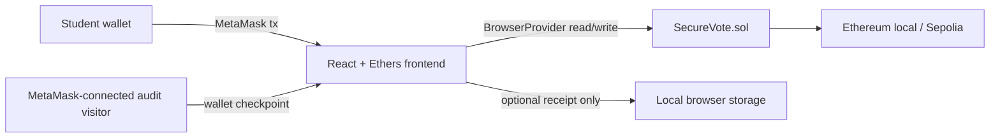

# Architecture

The chain is the backend. The frontend requires MetaMask for every route except the landing page, signs writes through the connected `BrowserProvider`, waits for actual receipts, and re-reads state. There is no read-only RPC fallback for route access. Local storage contains only the optional voter receipt needed to recover the secret for reveal.

MetaMask connection is not student eligibility. The contract's voter registry remains the authority for eligibility, while the wallet address and reveal transaction are public blockchain data.
